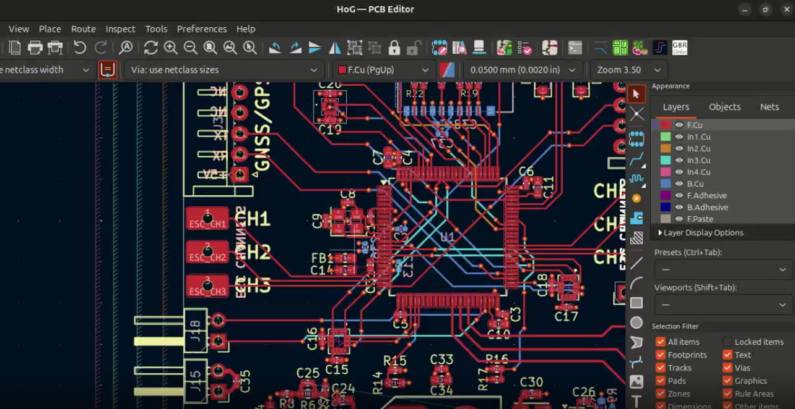
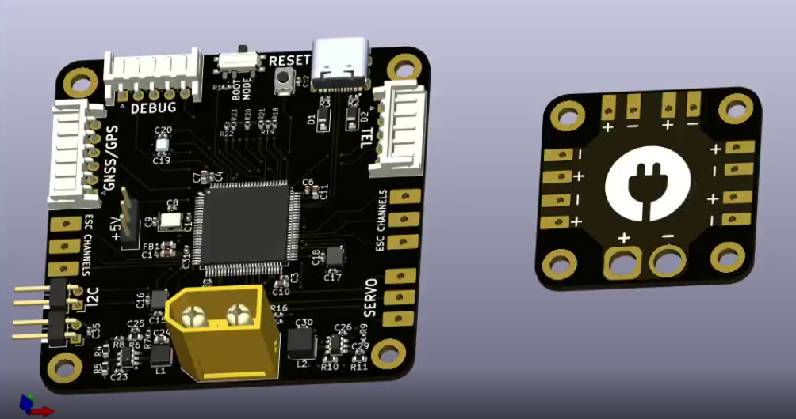
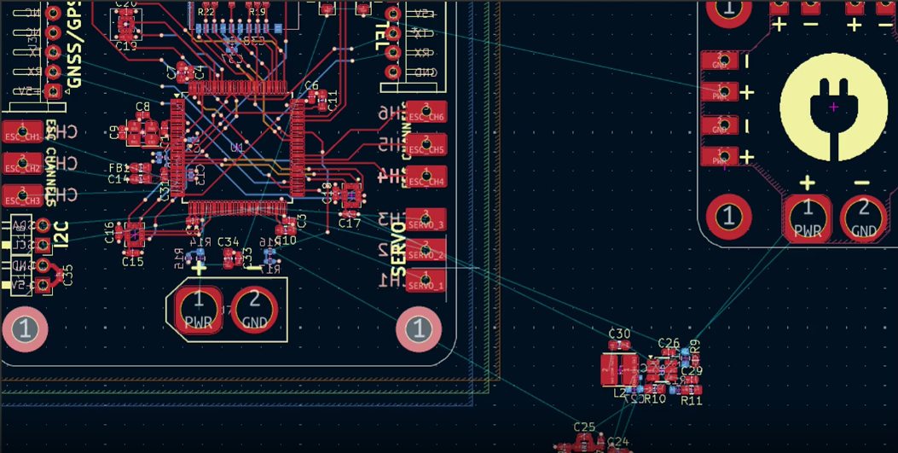
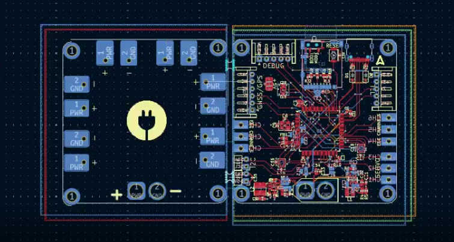
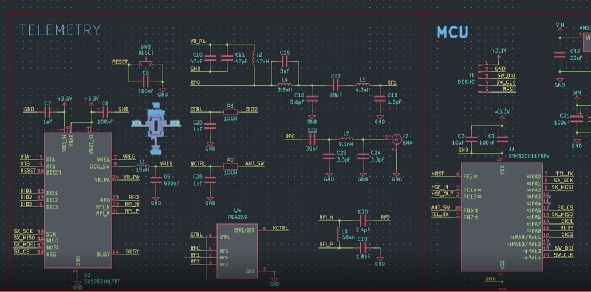
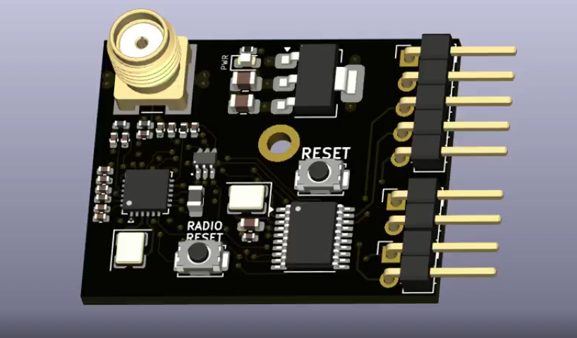
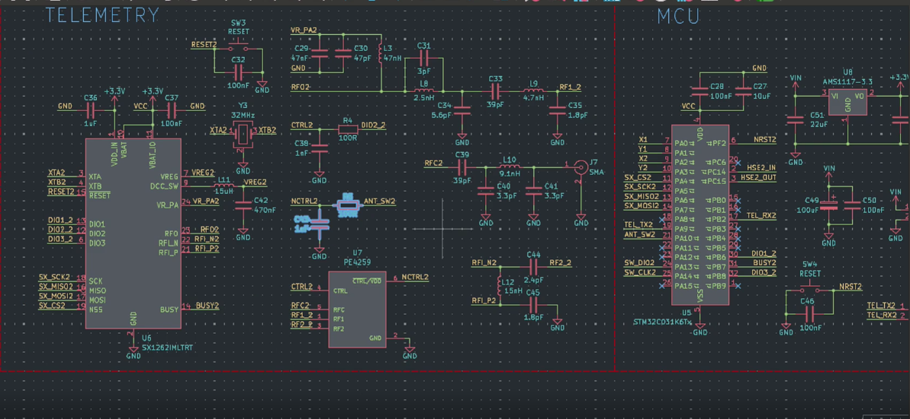
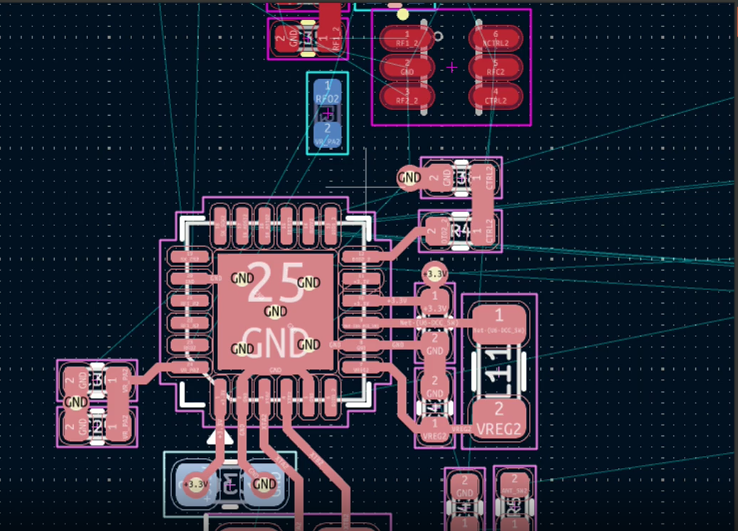

# Day 1

First, I set up the entire project in cubemx. I added comms protocols, breakouts, crystal oscillators, etc. After that, I added the required stuff in KiCAD. Here I added 2 ICM45686 IMUs, 1 BMP581 Barometer, and then breakouts for power output. Then, I wired up the stuff I added here using the existing datasheets. I used the stm32h743vit6 as the mcu as it is very powerful. Although, I reckon I could've used the stm32f405rgt6 as it is cheaper and widely used in a lot of consumer oriented drone flight computers.  
https://lapse.hackclub.com/timelapse/S5AEKcWjFcFN

Then, I wired up the 2 power sections consisting of +5V and +3.3V outputs. The +3.3V output is for the internal components like the MCU, IMU, Barometer, etc. while, the +5V output is for the servos and some external components that may required higher voltages. Here, I finished the entire wiring up within 2 hours. It was pretty easy ngl. Then, I did the ERC and fixed any errors. Finally, after that I assigned the footprints and the schematics part was over.  
https://lapse.hackclub.com/timelapse/Qf_AoOY-mgPN

Firstly, I looked at the 3d version of the pcb to look for any problematic footprints. I found two here, so I fixed them. After that, I localized everything to separate sections. Then, I wired up the decoupling capacitors and the crystal to the mcu. For me, this is a default habit as they have to be as close as possible without interfering with other routes/components. Then, I set up bounds and tried planning out the board. I then placed the power sections on one side and routed them. I decided to use a 6 layer pcb as it is way easier to route that than a 2 layer one. If I hadn't used a 6 layer pcb, I probably wouldn't be able to submit this project on time.
https://lapse.hackclub.com/timelapse/OmWuiVIgm5il

This is where the flight computer really started coming together. First, I added some extra breakout pins for the servos and power. Then, for the ESC connection pads, I was confused on the footprint that I had to use but later decided to modify an already existing footprint for a solder pad. Then, I basically locked in and routed everything together utilizing 5/6 layers and 1 layer has to be a solid ground. I may change this in the following week to a 4 layer pcb as it is significantly cheaper to fabricate.  
https://lapse.hackclub.com/timelapse/38z7tmix-HnZ

This was the day the flight computer got aestheticized. Firstly, I made the power distribution unit. This was a good idea as I do not want the noisy servo ground to come in contact with my telemetry ground. This would just make the board act up in the worst case scenario. Then, I tried adding a hog rider to make it in-theme with the board's name but it turned out horrible so I ditched it. Then I moved on to adding all the required text for the board like pin names and some form of branding. After that, the board is officially complete!  
https://lapse.hackclub.com/timelapse/FG-Le-8sbzr-

Note: I may add some changes in the following week.

# Day 2

Since I wanted to lower the fabrication costs, I lowered the layer count on the flight controller from 6 layers to 4. As a result, I'll now have to redo some of the routing to make it cleaner and also aesthetically pleasing. Tbh, no pcb I've made is as pretty as I expect it to be. It just turns out to look moderately good. I tried my best not to use the gnd layers but I had to use it at two locations. I mean, it shouldn't be THAT big of a problem.

Next up, I shrunk the main flight controller and enlarged the power distribution unit. The previous version was just a tad bit in a weird form factor to my liking. Oh yeah and I also changed extra +5V pins to solder pads. Thats basically all the rework done. Now I'll start work on the telemetry unit.

https://lapse.hackclub.com/timelapse/r8waVymlZS5T

https://lapse.hackclub.com/timelapse/mZGoj2DNjKys

# Day 3

I started work on the schematics for the telemetry module. I've planned it to be controlled via a computer so there will not be any joysticks. Orrr now that i think of it, maybe I should add joysticks and only make the camera output on a computer. I used the sx1262 as the LoRa chip. It should work as expected since I've got no experience with it before and just followed the reference diagram. I also chose a very small stm32 chip bc i didn't really need that many pins tbh. With that, schematics were over.

https://lapse.hackclub.com/timelapse/wV412dP2dNCY

# Day 4

I routed the entire board today. I used 4 layers as its an RF module. I tried my best not to use the ground layer but I had to use a small portion at a spot. Initially, I used 0.2mm traces. They looked pretty good imo but they gave me via clearance issues. So, I later switched to 0.1mm traces. I made the entire telemetry module as compact as I could make it while also including a single m2 mounting hole at the center of the board.

https://lapse.hackclub.com/timelapse/GlbSt3y3Jzp2

# Day 5

Basically, all I did today was design the radio transmitter. First I setup the pins in cubemx. I planned of using 2 joysticks so, I setup 4 adc channels for that purpose. Then, I did some comms config and then copied over the sx1262 schematics from the receiver section. Then, I used a different mcu as the one used in the receiver wouldn't really be sufficient for the transmitter due to low pin count. Finally, I routed everything and made the form factor somewhat close to the receiver BUT I couldn't add the mounting hole. So, this one will have to be either hot glued or slotted onto the case. That's about it for the entire drone.

https://lapse.hackclub.com/timelapse/t4q8llYZos55

