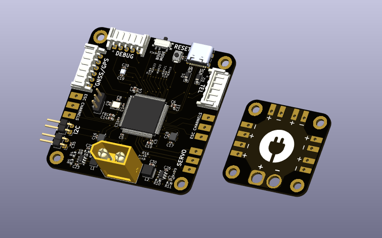
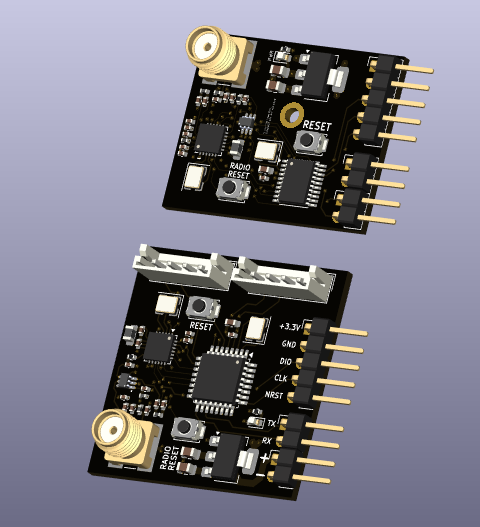
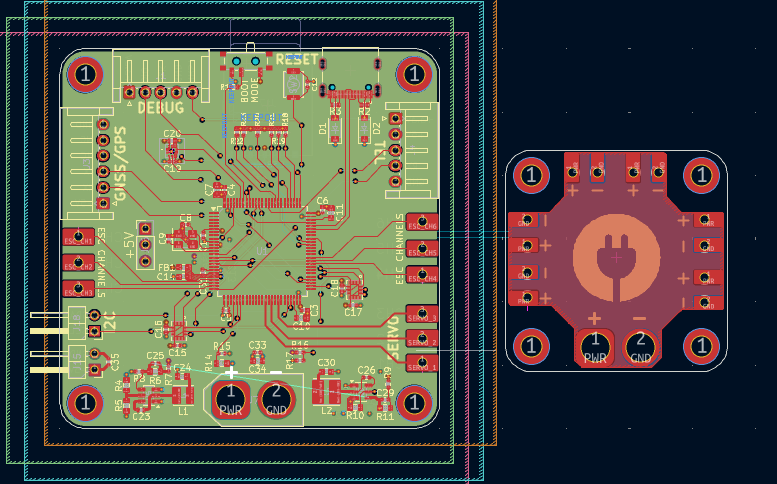
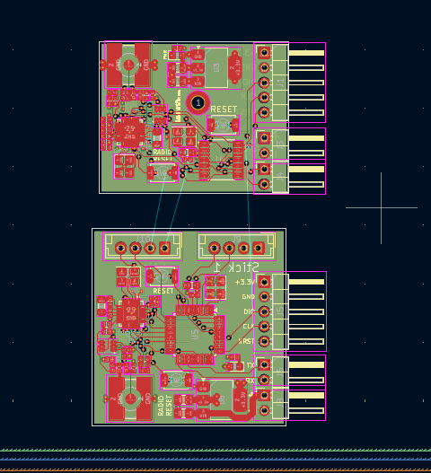
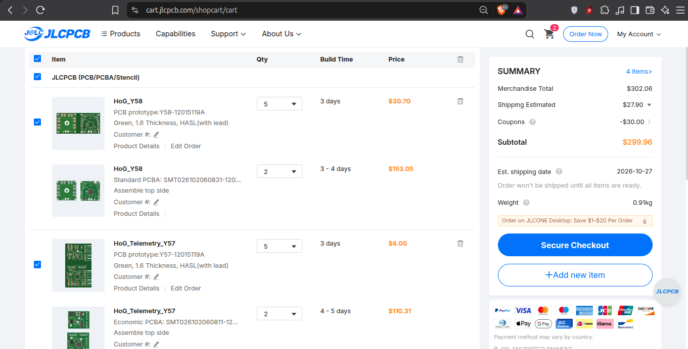

# HoG FC

This repository includes the custom flight controller, a PDU, and a telemetry unit that is to be used in the drone.

# Overviews

Hand of God flight controller is a custom STM32-based drone flight computer intended to be deployed for humanitarian aid missions.

See [FC Schematics](Kicad/FC/HoG.pdf)
See [Telemetry Schematics](Kicad/Telemetry/HoG_Telemetry.pdf)

## Routing

# Features

## Core

- STM32H743 Cortex-M7 MCU
- Up to 480 MHz CPU clock
- MicroSD storage
- SWD debugging
- USB-C
- Barometer
- Gyroscope & Accelerometer
- GPS/GNSS

## Power

The flight controller board provides dedicated:

- 22.2 V rail (6s nominal)
- 5 V rail
- 3.3 V rail

## Rough BOM

| #   | Item           |        Cost | Supplier    |
| --- | -------------- | ----------: | ----------- |
| 1   | PCBs           |     $299.96 | JLCPCB      |
| 2   | SMD Resistors  |       $8.35 | Daraz Nepal |
| 3   | SMD Capacitors |       $7.98 | Daraz Nepal |
|     | **Total**      | **$316.29** |             |

# Authors 👥

Shaurya (Electronics)  
Contact: [E-mail](shauryatamang.dev@gmail.com)

Krish (CAD)  
View: [Github](https://github.com/unknowngamer69/God-s-Hand)
