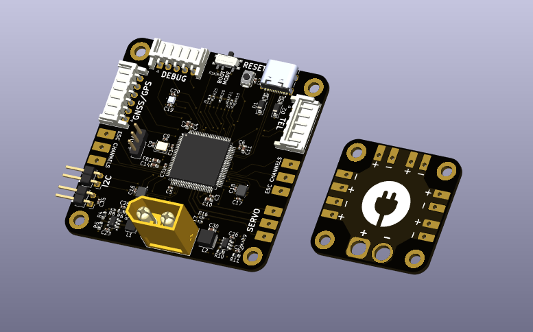
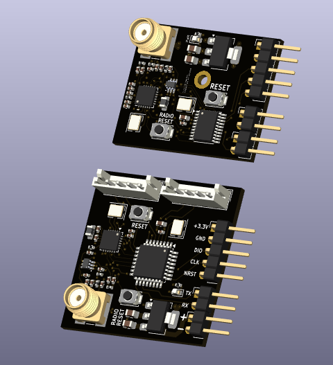
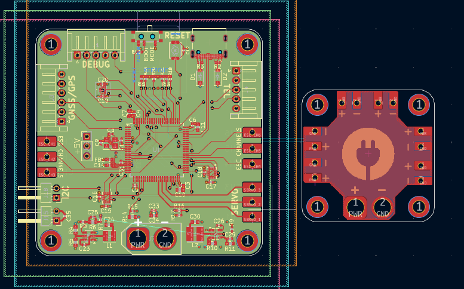
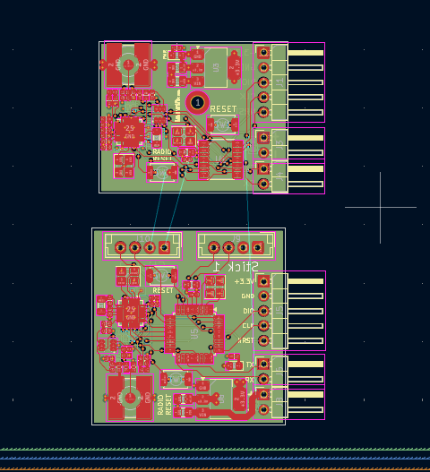
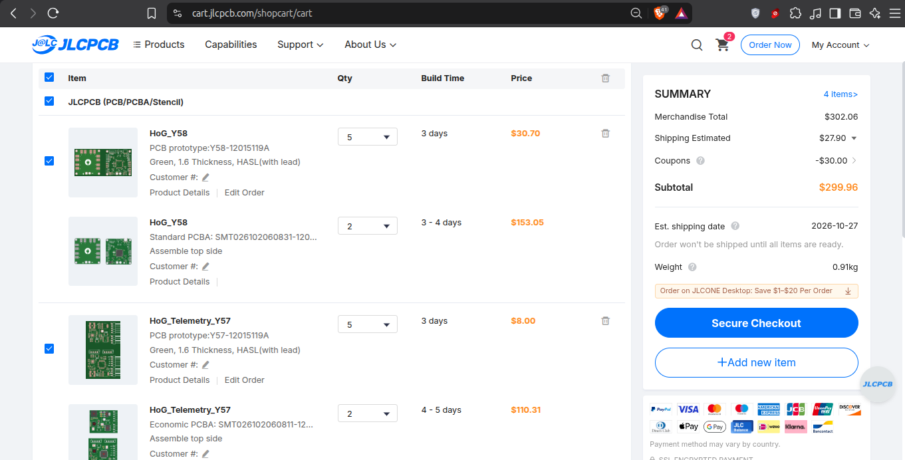

# HoG FC
This is my first dedicated drone flight computer. It may appear a bit odd because of the lack of an esc pcb on most commercial FCs. Mine is supposed to be used with high current external ones.

This repository includes the custom flight controller, a PDU, and a telemetry unit that is to be used in the drone.

# Overviews

Hand of God flight controller is a custom STM32-based drone flight computer intended to be deployed for humanitarian aid missions.

I decided not to design an esc for cost optimization. (Also due to the fact that I'm not feeling that interested in designing an esc atm ;p)

See [FC Schematics](Kicad/FC/HoG.pdf)
See [Telemetry Schematics](Kicad/Telemetry/HoG_Telemetry.pdf)

## Routing

# Features

## Core

- STM32H743 Cortex-M7 MCU
- Up to 480 MHz CPU clock
- MicroSD storage
- SWD debugging
- USB-C
- Barometer
- Gyroscope & Accelerometer
- GPS/GNSS

## Power

The flight controller board provides dedicated:

- 22.2 V rail (6s nominal)
- 5 V rail
- 3.3 V rail

## Rough BOM

| #   | Item           |        Cost | Supplier    |         Link |
| --- | -------------- | ----------: | ----------- |--------------|
| 1   | PCBs           |     $299.96 | JLCPCB      |[JLCPCB](https://jlcpcb.com/)
| 2   | SMD Resistors  |       ~$6.94~ $0 | Daraz Nepal |[Link](https://www.daraz.com.np/products/1500-pcs-smd-0603-resistors-assorted-set-60-values-x-25pcs-0ohm-10m-ohm-110-watt-1-high-precision-film-chip-resistance-kit-i1514216410-s12309713785.html?c=&channelLpJumpArgs=&clickTrackInfo=query%253Asmd%252Bresistors%253Bnid%253A1514216410%253Bsrc%253ALazadaMainSrp%253Brn%253Ac9682d867323cda46b1ca58a60ed35cf%253Bregion%253Anp%253Bsku%253A1514216410_NP%253Bprice%253A1027%253Bclient%253Adesktop%253Bsupplier_id%253A900279168309%253Bsession_id%253A%253Bbiz_source%253Ahttps%253A%252F%252Fwww.daraz.com.np%252F%253Bslot%253A29%253Butlog_bucket_id%253A470687%253Basc_category_id%253A10000489%253Bitem_id%253A1514216410%253Bsku_id%253A12309713785%253Bshop_id%253A198893%253BtemplateInfo%253A&configId=choice_NP_promotion&freeshipping=0&fs_ab=1&fuse_fs=&lang=en&location=Overseas&price=1027&priceCompare=skuId%3A12309713785%3Bsource%3Alazada-search-voucher%3Bsn%3Ac9682d867323cda46b1ca58a60ed35cf%3BoriginPrice%3A102700%3BdisplayPrice%3A102700%3BisGray%3Afalse%3BsinglePromotionId%3A-1%3BsingleToolCode%3AmockedSalePrice%3BvoucherPricePlugin%3A0%3Btimestamp%3A1795232346799&ratingscore=&request_id=c9682d867323cda46b1ca58a60ed35cf&review=&sale=0&search=1&source=search&spm=a211g0.searchlist.list.29&stock=1&upItemIds=1514216410)    |
| 3   | SMD Capacitors |       ~$6.64~ $0 | Daraz Nepal |[Link](https://www.daraz.com.np/products/320pcs-720pcs-2500pcs-0603-0805-1206-smd-capacitor-kit-assorted-kit-163650values-pumudsy-1pf-1uf-i492412636-s2210944926.html)    |
|     | **Total**      | **$299.96** |             |             |

# Author

Shaurya Tamang 
Contact: [E-mail](shauryatamang.dev@gmail.com)
